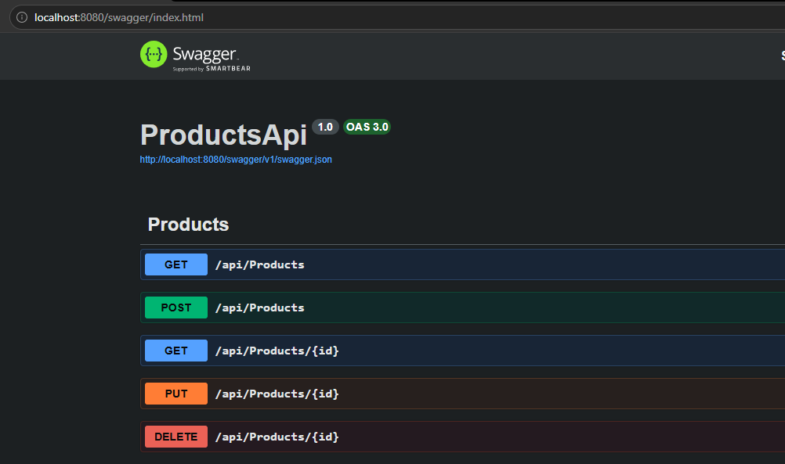
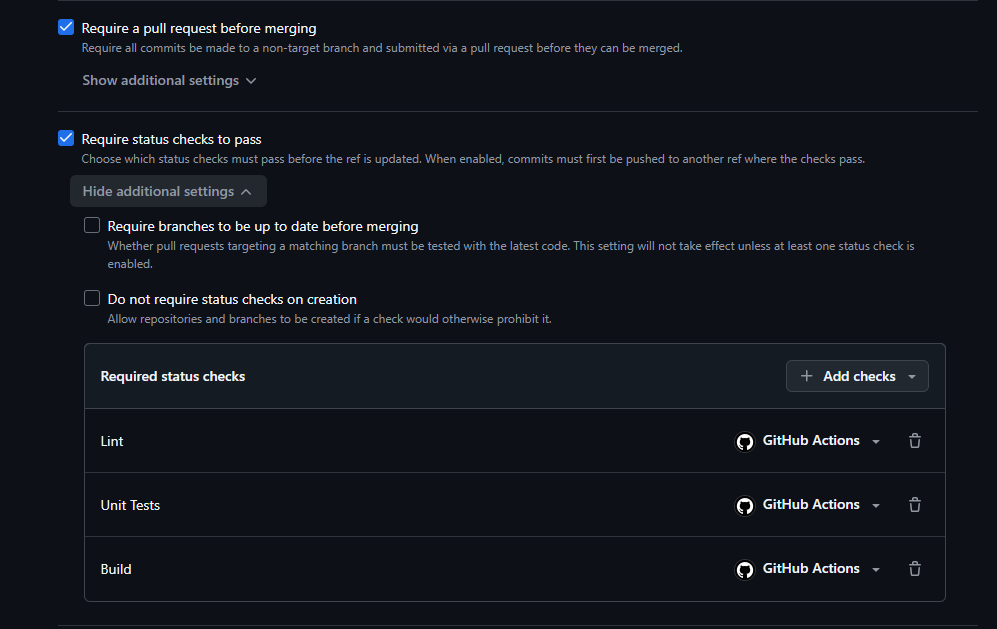
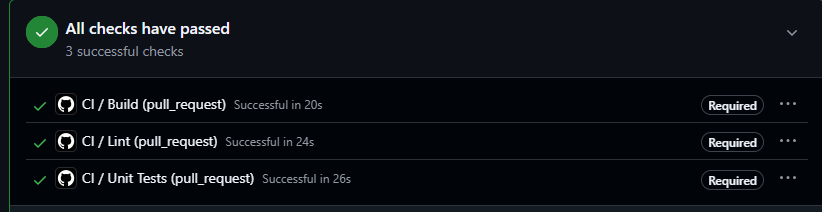
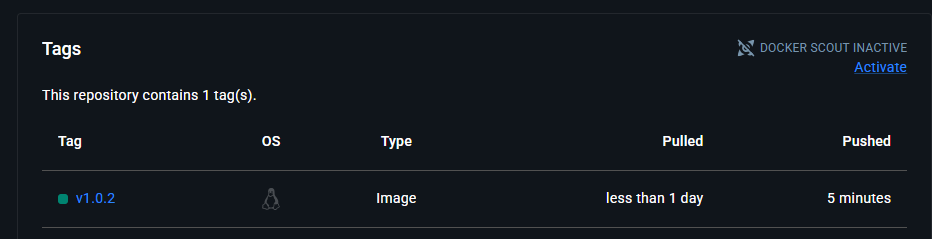
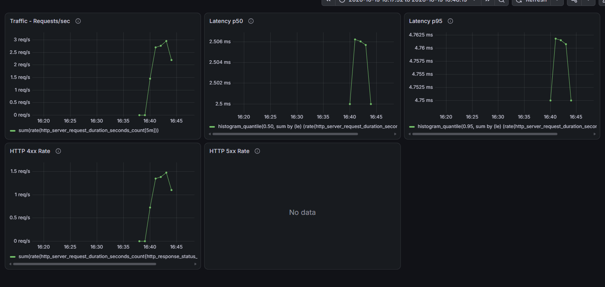
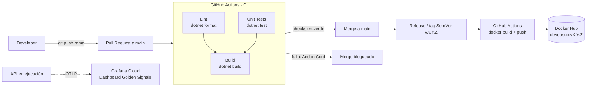
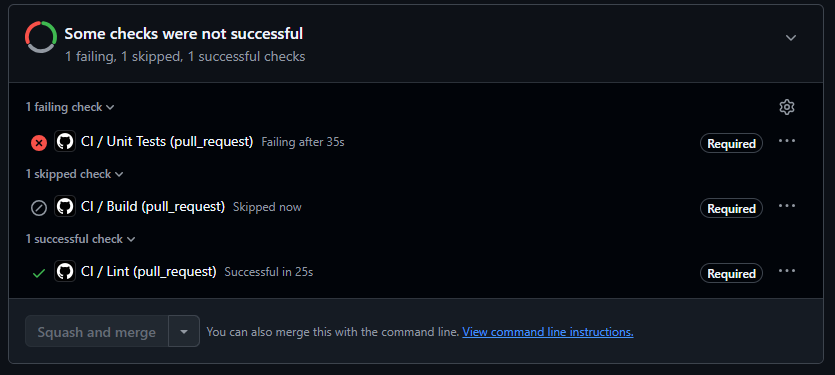

# DevOpsUP — ProductsApi

API REST de gestión de productos desarrollada como Trabajo Práctico Integrador de la materia DevOps. Cubre el ciclo de vida completo: desarrollo, tests, versionado, empaquetado con Docker, CI/CD con GitHub Actions y observabilidad con OpenTelemetry y Grafana Cloud.

## Tabla de contenidos

1. [Requisitos previos](#requisitos-previos)
2. [Estructura del proyecto](#estructura-del-proyecto)
3. [Cómo ejecutar la API](#cómo-ejecutar-la-api)
4. [Endpoints disponibles](#endpoints-disponibles)
5. [Cómo correr los tests](#cómo-correr-los-tests)
6. [Docker y Docker Compose](#docker-y-docker-compose)
7. [Flujo de trabajo (branching)](#flujo-de-trabajo-branching)
8. [Convención de commits](#convención-de-commits)
9. [Integración continua](#integración-continua)
10. [Estrategia de versionado](#estrategia-de-versionado)
11. [Publicación Docker](#publicación-docker)
12. [Observabilidad y monitoreo](#observabilidad-y-monitoreo)
13. [Informe técnico](#informe-técnico)

---

## Requisitos previos

- [.NET SDK 10.0](https://dotnet.microsoft.com/download) o superior (`dotnet --version` debe reportar `10.0.400` o compatible).
- Git.
- Docker y Docker Compose (para ejecutar en contenedor).
- Visual Studio 2026 o VS Code con la extensión de C#.

## Estructura del proyecto

```
DevOpsUP/
├── .github/workflows/
│   ├── ci.yml                             # CI: lint, tests y build en cada PR
│   └── docker-publish.yml                 # Build y push a Docker Hub al publicar un tag vX.Y.Z
├── docs/evidencias/                       # Capturas usadas en el informe
├── grafana/dashboards/
│   └── products-api-golden-signals.json   # Dashboard personalizado (Golden Signals)
├── src/
│   └── ProductsApi/                       # Proyecto principal (API)
│       ├── Controllers/
│       │   └── ProductsController.cs      # Endpoints CRUD de productos
│       ├── Middleware/
│       │   └── JsonRequestLoggingMiddleware.cs  # Logs JSON por request
│       ├── Models/
│       │   └── Product.cs                 # Modelo de dominio
│       ├── Services/
│       │   ├── IProductService.cs         # Contrato del servicio
│       │   └── InMemoryProductService.cs  # Implementación en memoria
│       ├── Program.cs                     # Configuración y arranque de la app
│       └── appsettings.json
├── tests/
│   └── ProductsApi.Tests/                 # Tests unitarios (xUnit + Moq)
│       └── ProductsControllerTests.cs
├── .dockerignore
├── .env.example                           # Variables de entorno de ejemplo (OTLP)
├── Dockerfile                             # Multi-stage, non-root
├── docker-compose.yml                     # Entorno local reproducible
├── DevOpsUP.slnx                          # Archivo de solución
└── README.md
```

## Cómo ejecutar la API

Desde la raíz del repositorio:

```bash
dotnet run --project src/ProductsApi
```

La API queda disponible en la URL indicada en consola (por defecto sería algo como `https://localhost:xxxx`). También se puede explorar y probar todos los endpoints desde Swagger UI, disponible en:

```
https://localhost:xxxx/swagger
```

La documentación interactiva (Swagger / OpenAPI) también queda expuesta en el contenedor (entorno `Production`): `http://localhost:8080/swagger`.



## Endpoints disponibles

| Método | Ruta | Descripción |
|--------|------|-------------|
| GET | `/api/products` | Lista todos los productos |
| GET | `/api/products/{id}` | Obtiene un producto por ID |
| POST | `/api/products` | Crea un nuevo producto |
| PUT | `/api/products/{id}` | Actualiza un producto existente |
| DELETE | `/api/products/{id}` | Elimina un producto |

## Cómo correr los tests

Desde la raíz del repositorio:

```bash
dotnet test tests/ProductsApi.Tests
```

El proyecto de tests utiliza xUnit como framework de testing y Moq para simular dependencias (`IProductService`), cubriendo los principales casos de uso del `ProductsController`.

## Docker y Docker Compose

### Dockerfile

| Práctica | Implementación |
|----------|----------------|
| Multi-stage build | Etapa `build` con `dotnet/sdk:10.0` y etapa final con `dotnet/aspnet:10.0-noble-chiseled` |
| Imagen base ligera y específica | Imagen *chiseled* (mínima, sin shell ni gestor de paquetes). No se usa el tag `latest` |
| Usuario non-root | `USER app` en la imagen final |
| Optimización de caché | Primero se copian solo los `.csproj` y se ejecuta `dotnet restore`; recién después se copia el código fuente. Si solo cambia el código, la capa de dependencias se reutiliza |

### Docker Compose

Levantar el entorno completo con un solo comando:

```bash
cp .env.example .env      # completar con los datos OTLP de Grafana Cloud
docker compose up --build
```

La API queda disponible en `http://localhost:8080` (Swagger en `http://localhost:8080/swagger`).

| Variable | Descripción |
|----------|-------------|
| `OTEL_EXPORTER_OTLP_ENDPOINT` | Endpoint OTLP de Grafana Cloud |
| `OTEL_EXPORTER_OTLP_HEADERS` | Cabeceras de autenticación OTLP |

> Los valores reales viven en `.env`, que no se versiona.

## Flujo de trabajo (branching)

Este proyecto sigue un modelo simplificado de GitHub Flow:

- `main`: rama protegida, siempre estable y desplegable. No se permite push directo.
- `feature/*`, `fix/*`, `docs/*`: ramas de trabajo de corta duración, integradas a `main` exclusivamente mediante **Pull Requests**.

La protección se aplica con un **ruleset** sobre `main`:

- Pull Request obligatorio antes de mergear.
- Checks de estado requeridos: `Lint`, `Unit Tests` y `Build`.
- Force push y borrado de la rama bloqueados.



## Convención de commits

El historial de commits sigue la especificación de Conventional Commits:

| Prefijo | Uso |
|---------|-----|
| `feat:` | Nueva funcionalidad |
| `fix:` | Corrección de errores |
| `docs:` | Cambios en documentación |
| `test:` | Agregado o modificación de tests |
| `refactor:` | Cambios de código que no alteran el comportamiento |
| `chore:` | Tareas de mantenimiento (configuración, dependencias, etc.) |
| `ci:` | Cambios en la configuración de integración continua |

## Integración continua

El workflow `.github/workflows/ci.yml` se ejecuta en cada Pull Request hacia `main` y está dividido en jobs modulares:

| Job | Qué hace |
|-----|----------|
| `Lint` | `dotnet format --verify-no-changes` (verifica el formato del código) |
| `Unit Tests` | `dotnet test` en modo Release |
| `Build` | `dotnet build` en Release. Depende de `Lint` y `Unit Tests` (`needs`) |

Un Pull Request solo puede mergearse si estos jobs finalizan exitosamente (Andon Cord).



## Estrategia de versionado

El proyecto utiliza Semantic Versioning (SemVer) para el etiquetado de releases, con el formato MAJOR.MINOR.PATCH (ej: v1.0.0):

- MAJOR: cambios incompatibles en la API.
- MINOR: nuevas funcionalidades compatibles con versiones anteriores.
- PATCH: correcciones de errores compatibles con versiones anteriores.

Cada versión se publica como un **Release de GitHub** asociado a un tag `vX.Y.Z` sobre `main`. Ese tag es el que dispara la publicación de la imagen Docker, de modo que el artefacto en Docker Hub queda trazable a un release y a un commit concretos.

La última versión publicada es **`v1.0.2`**.


## Publicación Docker

El proyecto cuenta con un workflow de GitHub Actions que construye y publica automáticamente la imagen Docker en Docker Hub.

### Publicación automática

El workflow `.github/workflows/docker-publish.yml` se ejecuta automáticamente cuando se publica un tag con formato SemVer, por ejemplo:

```text
v1.0.2
```

El workflow realiza las siguientes tareas:

- Inicia sesión en Docker Hub.
- Construye la imagen utilizando el `Dockerfile`.
- Publica la imagen en Docker Hub con el mismo tag de la versión.

### Imagen Docker

La imagen publicada está disponible en:

```text
sdcsoftsolutions/devopsup:v1.0.2
```

Para descargarla:

```bash
docker pull sdcsoftsolutions/devopsup:v1.0.2
```

Para ejecutar la imagen:

```bash
docker run -p 8080:8080 sdcsoftsolutions/devopsup:v1.0.2
```

Luego, la API estará disponible en:

```text
http://localhost:8080
```

Evidencia de la publicación del tag `v1.0.2` en Docker Hub:



### Secretos de GitHub Actions

La publicación en Docker Hub utiliza los siguientes secretos configurados en GitHub:

- `DOCKERHUB_USERNAME`
- `DOCKERHUB_TOKEN`

### Despliegue continuo (CD)

El despliegue automático mediante Deploy Hook (desafío opcional) no está implementado. Actualmente el pipeline llega hasta la publicación de la imagen en Docker Hub. Queda como trabajo futuro.

## Observabilidad y monitoreo

### Logs estructurados (JSON)

El middleware `JsonRequestLoggingMiddleware` emite un evento JSON por request con `timestamp`, `level`, `method`, `path`, `status_code`, `duration_ms` y `message`. El nivel depende del status: 2xx/3xx `Information`, 4xx `Warning` y 5xx `Error`. Los logs de la aplicación (`ILogger`) también se formatean en JSON.

```json
{"timestamp":"2026-10-19T19:30:00.1230000Z","level":"Information","method":"GET","path":"/api/products","status_code":200,"duration_ms":3.4,"message":"HTTP request completed"}
```

### Telemetría con OpenTelemetry y Grafana Cloud

La aplicación se instrumenta con OpenTelemetry (ASP.NET Core y Runtime) y exporta trazas y métricas por OTLP hacia Grafana Cloud. El endpoint y las credenciales se inyectan por variables de entorno (`OTEL_EXPORTER_OTLP_*`), sin secretos en el código.

### Dashboard personalizado (Golden Signals)

El dashboard fue construido desde cero, sin plantillas, y su definición está versionada en `grafana/dashboards/products-api-golden-signals.json`.

| Señal | Panel |
|-------|-------|
| Tráfico | Requests por segundo / RPM |
| Latencia | Percentiles p50 y p95 |
| Errores | Conteo de respuestas HTTP 4xx y 5xx |



## Informe técnico

### 1. Arquitectura del pipeline



| Componente | Herramienta |
|------------|-------------|
| Control de versiones y PRs | GitHub |
| Linter | `dotnet format` |
| Runner de CI | GitHub Actions (`ubuntu-latest`) |
| Tests | xUnit + Moq |
| Versionado y releases | SemVer + GitHub Releases |
| Registro de imágenes | Docker Hub |
| Observabilidad | OpenTelemetry + Grafana Cloud |
| Hosting | No aplica (CD opcional no implementado) |

### 2. Justificación técnica y decisiones de diseño

**Optimización de contenedores**

- **Imagen base:** `aspnet:10.0-noble-chiseled`, mínima y sin shell ni gestor de paquetes. Reduce tamaño y superficie de ataque. Se fija una versión específica, nunca `latest`.
- **Multi-stage:** el SDK, que es pesado, solo se usa para compilar. La imagen final contiene únicamente el runtime y los binarios publicados.
- **Capas y caché:** se copian primero los `.csproj` y se restauran las dependencias. Esa capa solo se invalida si cambian las dependencias, no con cada cambio de código.
- **Seguridad:** la aplicación corre con el usuario no privilegiado `app`.

**Estrategia de integración**

- **GitHub Flow (trunk-based simplificado):** `main` siempre estable, ramas cortas y PRs obligatorios.
- **Protección de ramas:** ruleset activo sobre `main` con PR obligatorio y checks `Lint`, `Unit Tests` y `Build` requeridos.
- **Versionado:** SemVer mediante Releases de GitHub con tags `vX.Y.Z`, que disparan la publicación de la imagen con ese mismo tag.

### 3. Aplicación de la filosofía DevOps

**Primera Forma: flujo y consistencia**

- *Tareas 100% automatizadas:* verificación de formato, ejecución de tests, compilación, build de la imagen Docker y publicación en Docker Hub con el tag de versión.
- *Entorno idéntico:* el mismo `Dockerfile`, con versiones fijas de imagen base, se usa en local (`docker compose`) y en el pipeline de publicación. Lo que se prueba es lo que se publica.

**Segunda Forma: feedback rápido y Andon Cord**

- *Dónde corta el pipeline:*
  1. `Lint`: si el código no cumple el formato, falla.
  2. `Unit Tests`: si una prueba falla, falla.
  3. `Build`: no corre si alguno de los anteriores falló (`needs`).

  Con los tres checks requeridos en el ruleset de `main`, el PR no puede mergearse.
- *Visibilidad de fallos en ejecución:* los errores HTTP 5xx y la latencia alta se detectan en el dashboard de Grafana Cloud mediante métricas de OpenTelemetry (conteo de 4xx/5xx y percentiles p50/p95). Se pueden correlacionar con los logs JSON (`status_code`, `path`, `duration_ms`).

**Tercera Forma: aprendizaje y simulación de fallos**

*Experimento 1: test unitario roto a propósito (CI).*

- **Escenario:** en la rama `fix/demo-test-fallido` se cambió el assert de `GetAll_ReturnsOkWithProductList` (de `2` a `99`) y se abrió un PR.
- **Reacción del sistema:** el job `Unit Tests` falló, `Build` no se ejecutó y GitHub bloqueó el merge por los checks requeridos del ruleset.
- **Corrección:** se restauró el test con el commit `fix: restaurar test`, los tres checks pasaron a verde y recién entonces se mergeó.
- **Aprendizaje:** el defecto quedó detenido en el PR, antes de llegar a `main` o a un artefacto publicado.




*Experimento 2: errores HTTP 4xx (monitoreo).*

- **Escenario:** se generó tráfico contra la API en ejecución, incluyendo muchas solicitudes a un recurso inexistente (`/api/products/999999`).
- **Reacción del sistema:** el panel de errores del dashboard de Grafana reflejó el aumento de respuestas 4xx, y los logs JSON registraron esas solicitudes con `level: Warning` y `status_code: 404`.


### 4. Principios Lean (reducción de desperdicio)

| Desperdicio (muda) | Cómo lo evita la solución |
|--------------------|---------------------------|
| Esperas y tareas manuales de compilación, prueba y empaquetado | CI y publicación automatizadas con GitHub Actions |
| Bugs detectados tarde, en producción | Lint y tests en cada PR (Andon Cord) más monitoreo con Golden Signals |
| Configuración manual y entornos inconsistentes ("en mi máquina funciona") | Dockerfile versionado y Docker Compose reproducible con un solo comando |